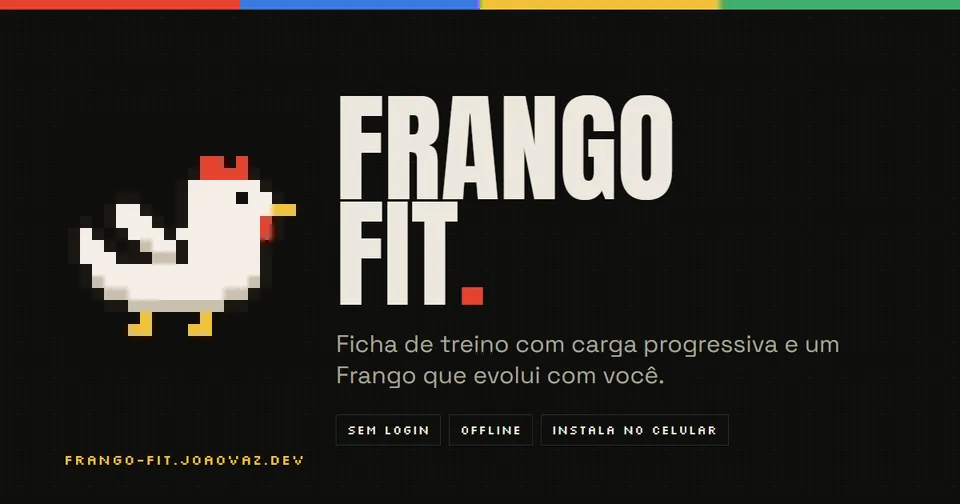
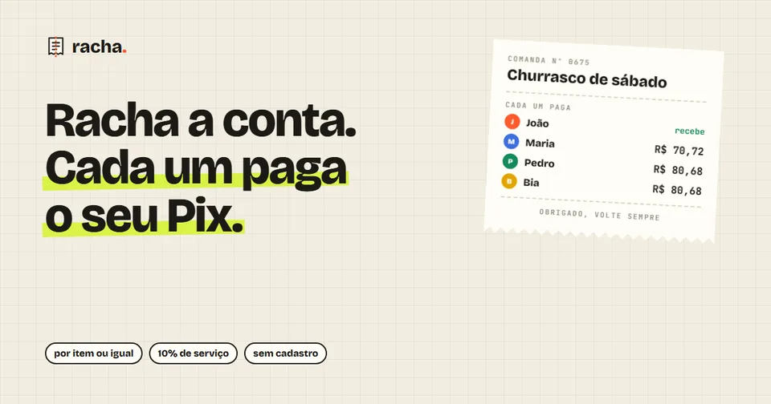
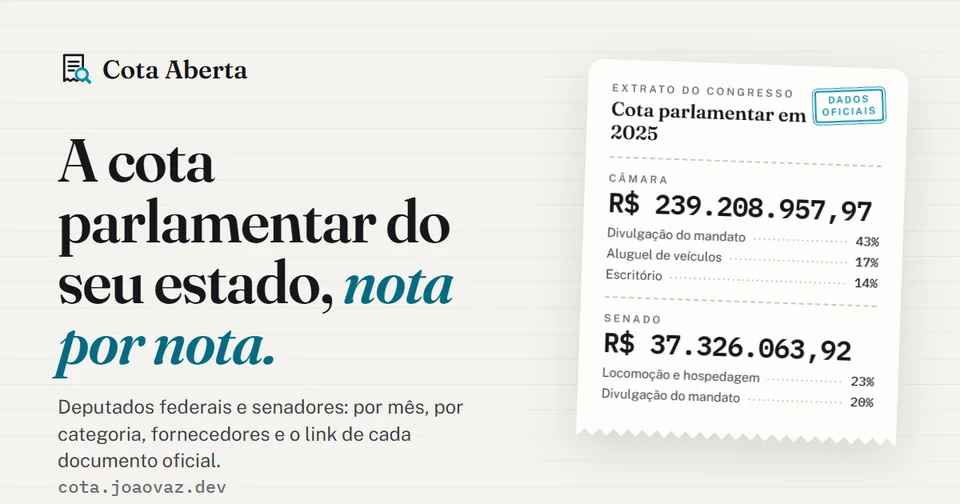
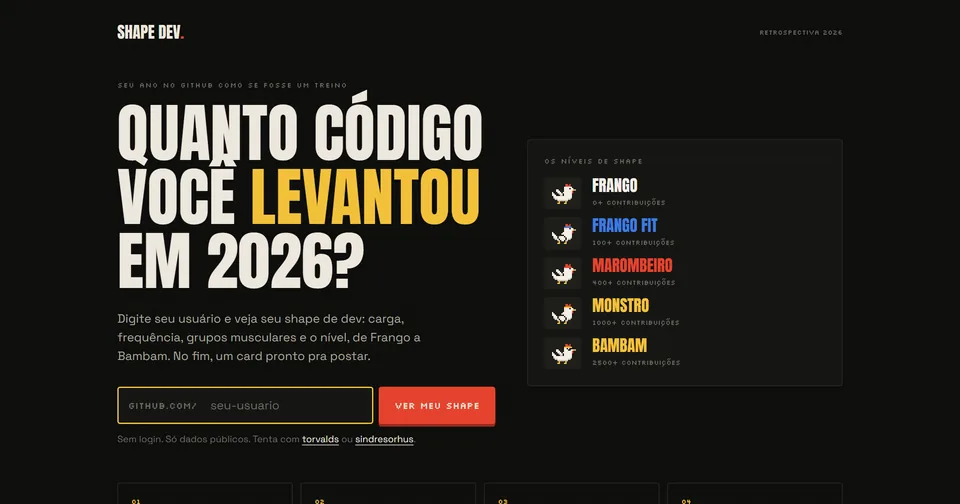
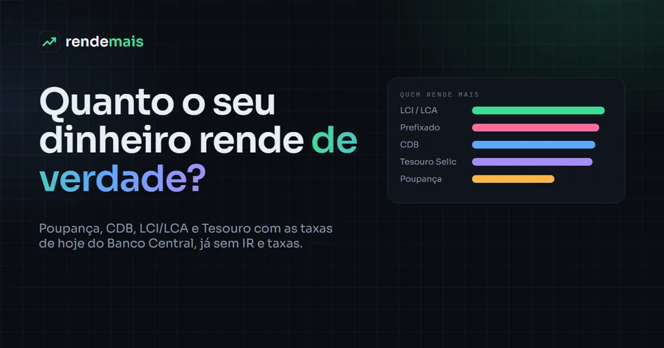
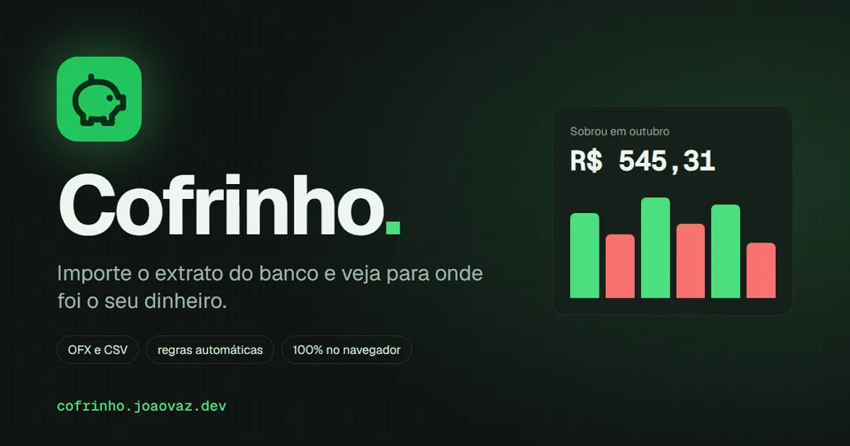

### Oi, eu sou o João 👋

Desenvolvedor **full stack** em Ribeirão Preto. Trabalho com tecnologia no **setor financeiro**, construindo painéis, automações e integrações que tiram trabalho manual do dia a dia.

Fora do código, sou vidrado em **academia**. As duas coisas funcionam igual: constância, carga progressiva e nenhum atalho que dure.

- 🏗️ Construindo agora: apps que resolvem coisa do dia a dia, de dividir a conta a ver quanto o dinheiro rende
- 🌐 Tudo no ar em **[joaovaz.dev](https://joaovaz.dev)**
- ⚙️ No trabalho: painéis internos, automação de rotinas e monitoramento
- 📍 Ribeirão Preto, SP

---

### 📈 Meu shape de 2026

Gerado pelo <a href="https://shape-dev-psi.vercel.app">Shape Dev</a> com as contribuições públicas e privadas do ano. Próxima meta: <b>Marombeiro</b> (400 contribuições). <a href="https://shape-dev-psi.vercel.app">Veja o seu →</a>

---

### 🏋️ Projetos

**9 apps no ar**, todos feitos do zero em Next.js. Abre, usa e, se curtir, deixa uma ⭐ no repositório.

<table>
  <tr>
    <td width="50%" valign="top">
      
      <h4><a href="https://frango-fit.joaovaz.dev">🐔 Frango Fit</a></h4>
      Ficha de treino com carga progressiva: sugere o peso da próxima série, detecta recordes e cronometra o descanso. No modo personal, a ficha vai pro aluno por link ou QR Code.
        
      <code>Next.js 16</code> <code>zustand</code> <code>PWA</code>
        
      <a href="https://frango-fit.joaovaz.dev"><b>▶ Abrir</b></a> · <a href="https://github.com/Bleachless/frango-fit">código</a>
    </td>
    <td width="50%" valign="top">
      
      <h4><a href="https://panteao.vercel.app">🏛️ Panteão</a></h4>
      Jogo de cartas por turnos para até 6 deuses, no computador ou no celular: sala por link, arena pública, replays e o chat da Twitch fazendo o papel de deus.
        
      <code>Next.js 16</code> <code>Ably</code> <code>Upstash Redis</code>
        
      <a href="https://panteao.vercel.app"><b>▶ Abrir</b></a> · <a href="https://github.com/Bleachless/panteao">código</a>
    </td>
  </tr>
  <tr>
    <td width="50%" valign="top">
      
      <h4><a href="https://racha.joaovaz.dev">🧾 Racha</a></h4>
      Divide a conta por item ou igual, lê o QR Code da nota fiscal e gera o Pix de cada pessoa. Um link vai pro grupo e cada um paga o seu.
        
      <code>Next.js 16</code> <code>Pix (BR Code)</code> <code>NFC-e</code>
        
      <a href="https://racha.joaovaz.dev"><b>▶ Abrir</b></a> · <a href="https://github.com/Bleachless/racha-pix">código</a>
    </td>
    <td width="50%" valign="top">
      
      <h4><a href="https://musica.joaovaz.dev">🎵 Vitrola</a></h4>
      Player que toca de verdade no navegador: paradas de hoje, discos independentes em Creative Commons, fila, playlists e controles na tela bloqueada.
        
      <code>Next.js 16</code> <code>Media Session API</code> <code>zustand</code>
        
      <a href="https://musica.joaovaz.dev"><b>▶ Abrir</b></a> · código privado
    </td>
  </tr>
  <tr>
    <td width="50%" valign="top">
      
      <h4><a href="https://cota-aberta.joaovaz.dev">🏛️ Cota Aberta</a></h4>
      Quanto o seu deputado e o seu senador usaram da cota parlamentar, pelo CEP ou pelo nome, nota por nota, com os dados oficiais da Câmara e do Senado.
        
      <code>Next.js 16</code> <code>APIs da Câmara e do Senado</code>
        
      <a href="https://cota-aberta.joaovaz.dev"><b>▶ Abrir</b></a> · código privado
    </td>
    <td width="50%" valign="top">
      
      <h4><a href="https://shape-dev-psi.vercel.app">💪 Shape Dev</a></h4>
      O seu ano no GitHub como se fosse um treino, em stories animados, com o nível de shape de Frango a Bambam e um card pronto pra postar.
        
      <code>Next.js 16</code> <code>next/og</code> <code>API do GitHub</code>
        
      <a href="https://shape-dev-psi.vercel.app"><b>▶ Abrir</b></a> · <a href="https://github.com/Bleachless/shape-dev">código</a>
    </td>
  </tr>
  <tr>
    <td width="50%" valign="top">
      
      <h4><a href="https://retrospix.joaovaz.dev">💸 Retrospix</a></h4>
      A retrospectiva do seu dinheiro em stories: pra quem você mais mandou Pix, o mês mais caro e as assinaturas esquecidas. O extrato nunca sai do aparelho.
        
      <code>Next.js 16</code> <code>OFX e CSV</code> <code>CSP</code>
        
      <a href="https://retrospix.joaovaz.dev"><b>▶ Abrir</b></a> · <a href="https://github.com/Bleachless/retrospix">código</a>
    </td>
    <td width="50%" valign="top">
      
      <h4><a href="https://rende-mais.joaovaz.dev">📈 Rende Mais</a></h4>
      Poupança, CDB, LCI, Tesouro e fundo DI lado a lado com as taxas de hoje do Banco Central, já com IR e inflação. E quanto guardar por mês pra bater a meta.
        
      <code>Next.js 16</code> <code>API do Banco Central</code> <code>Recharts</code>
        
      <a href="https://rende-mais.joaovaz.dev"><b>▶ Abrir</b></a> · <a href="https://github.com/Bleachless/rende-mais">código</a>
    </td>
  </tr>
  <tr>
    <td width="50%" valign="top">
      
      <h4><a href="https://cofrinho.joaovaz.dev">🐷 Cofrinho</a></h4>
      Importa o extrato em OFX ou CSV, categoriza sozinho e mostra pra onde foi o dinheiro, com metas e orçamentos. Tudo fica no navegador.
        
      <code>Next.js 16</code> <code>shadcn/ui</code> <code>Recharts</code>
        
      <a href="https://cofrinho.joaovaz.dev"><b>▶ Abrir</b></a> · <a href="https://github.com/Bleachless/cofrinho">código</a>
    </td>
    <td width="50%" valign="top">
      <h4>🔒 Trabalho interno</h4>
      Painel de monitoramento, painel de dados e robôs de planilha feitos para o dia a dia de uma equipe do setor financeiro. O código é privado, mas a constância aparece no mapa de contribuições.
        
      <code>Next.js</code> <code>NextAuth</code> <code>Python</code> <code>pandas</code> <code>Docker</code>
    </td>
  </tr>
</table>

---

### 🧰 Ferramentas do dia a dia

| Front-end | Back-end | Automação e infra |
| --- | --- | --- |
| React, Next.js, TypeScript, Tailwind CSS | Node.js, APIs REST, NextAuth, Zod | Python, pandas, Docker, Playwright, Git |

---

### 🤝 Bora conversar

🐔 Sem dor, sem deploy.
