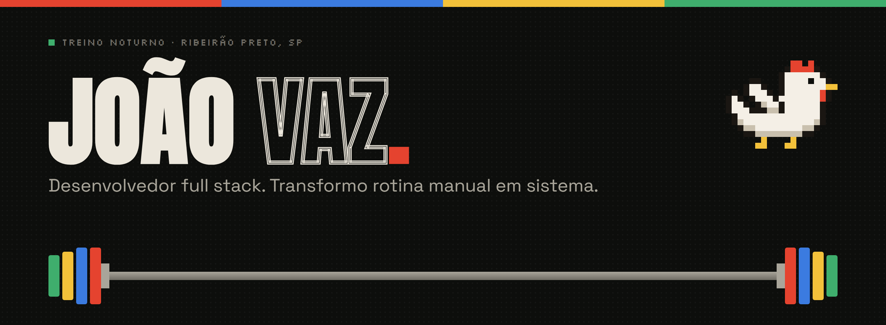
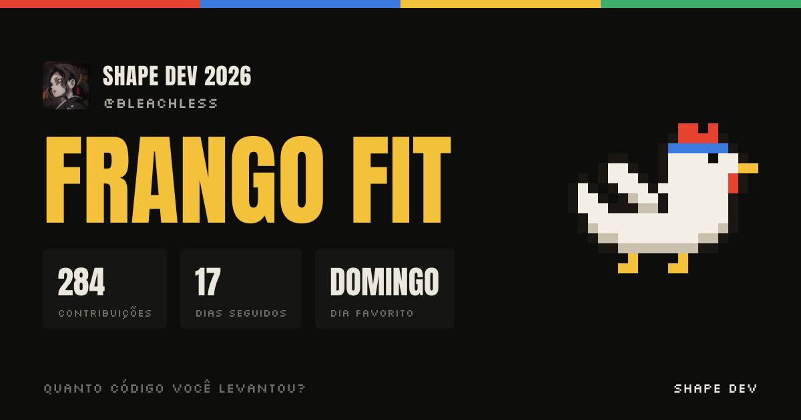

### Oi, eu sou o João 👋

Desenvolvedor **full stack** em Ribeirão Preto. Trabalho com tecnologia no **setor financeiro**, construindo painéis, automações e integrações que tiram trabalho manual do dia a dia.

Fora do código, sou vidrado em **academia**. As duas coisas funcionam igual: constância, carga progressiva e nenhum atalho que dure.

- 🏗️ Construindo agora: apps pessoais com cara de academia, todos abertos aqui embaixo
- ⚙️ No trabalho: painéis internos, automação de rotinas e monitoramento
- 📍 Ribeirão Preto, SP

---

### 📈 Meu shape de 2026

Gerado pelo <a href="https://github.com/Bleachless/shape-dev">Shape Dev</a> com as contribuições públicas e privadas do ano. Próxima meta: <b>Marombeiro</b> (400 contribuições).

---

### 🏋️ Projetos

<table>
  <tr>
    <td width="50%" valign="top">
      
      <h4><a href="https://github.com/Bleachless/frango-fit">🐔 Frango Fit</a></h4>
      Ficha de treino para usar no meio da série: sugere a próxima carga, detecta recordes, cronometra o descanso e tem um Frango que sobe de nível com você.
        
      <code>Next.js 16</code> <code>zustand</code> <code>PWA</code>
    </td>
    <td width="50%" valign="top">
      
      <h4><a href="https://github.com/Bleachless/cofrinho">🐷 Cofrinho</a></h4>
      Importa o extrato do banco (OFX ou CSV), categoriza sozinho e mostra para onde foi o dinheiro em gráficos. Tudo fica no navegador.
        
      <code>Next.js 16</code> <code>shadcn/ui</code> <code>Recharts</code>
    </td>
  </tr>
  <tr>
    <td width="50%" valign="top">
      
      <h4><a href="https://github.com/Bleachless/shape-dev">💪 Shape Dev</a></h4>
      Retrospectiva do ano no GitHub em formato de stories: frequência, sequência, linguagens e o seu nível de shape, com card pronto para postar.
        
      <code>Next.js 16</code> <code>next/og</code> <code>html-to-image</code>
    </td>
    <td width="50%" valign="top">
      <h4>🔒 Trabalho interno</h4>
      Painel de monitoramento, painel de dados e robôs de planilha feitos para o dia a dia de uma equipe do setor financeiro. O código é privado, mas a constância aparece no mapa de contribuições.
    </td>
  </tr>
</table>

---

### 🧰 Ferramentas do dia a dia

| Front-end | Back-end | Automação e infra |
| --- | --- | --- |
| React, Next.js, TypeScript, Tailwind CSS | Node.js, APIs REST, NextAuth, Zod | Python, pandas, Docker, Playwright, Git |

---

### 🤝 Bora conversar

🐔 Sem dor, sem deploy.
